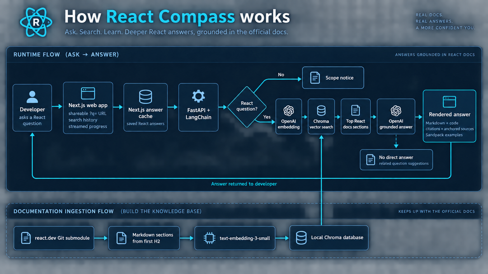

# React Compass

A small React documentation assistant built as two applications in one workspace:

- `web/` — Next.js UI and backend-for-frontend proxy
- `api/` — FastAPI, LangChain, and Chroma (local or Chroma Cloud)

The answer pipeline classifies every uncached question for React relevance and prompt-injection attempts. React questions continue through retrieval and grounded answer generation; other inputs receive a fixed scope notice without running RAG. The UI streams progress events, renders highlighted code, and turns React docs-style `<Sandpack>` examples into editable previews. The browser keeps the 15 most recent questions. Next.js caches successful React answers with its weekly cache profile and immediately invalidates no-match results and scope notices, so only grounded answers are reused. Removing a history entry also invalidates its cached React answer.

## How it works



## Run locally

1. Initialize the React documentation submodule:

   ```bash
   git submodule update --init --recursive
   ```

2. Copy the API environment template and add your OpenAI and LangSmith credentials:

   ```bash
   cp api/.env.sample api/.env
   ```

   The API is expected to run with `api/` as its working directory. `CHROMA_PATH` and
   `REACT_DEV_ROOT` may be absolute, or relative to that directory. `ALLOWED_ORIGINS` is
   a comma-separated list. `EMBEDDING_MODEL` selects the embedding model used by both
   ingestion and retrieval; changing it requires a separate or rebuilt Chroma database.
   Set it to `default` for Chroma's local default model, or use an OpenAI embedding model name.

3. Copy `web/.env.sample` to `web/.env.local` if the API does not run at `http://127.0.0.1:8000`.
4. Start the API:

   ```bash
   cd api
   uv sync --dev
   uv run fastapi dev app/main.py --port 8000
   ```

5. Start the web app in another terminal:

   ```bash
   cd web
   pnpm install
   pnpm dev
   ```

Open [http://localhost:3000](http://localhost:3000).

## Data

The generated Chroma collection is stored in `data/embeddings`. The directory is local-only and
Git-ignored because it contains generated vector data. From the `api/` working directory,
`CHROMA_PATH=../data/embeddings` selects it. Ingestion indexes sections beginning at the first
level-two heading, excluding the preamble from section text while retaining page metadata.
Files named `index.md` are skipped at every directory level because they link to other docs pages.
Rebuild existing collections to remove previously indexed chunks from these files.

Before splitting sections, ingestion replaces complete `<Sandpack>` examples with
`[Sandpack: <id>]` references, then replaces standalone fenced code blocks with
`[CodeSnippet: <id>]` references. Each chunk stores its referenced examples in
the JSON-encoded `sandpacks` and `code_snippets` metadata fields. Sandpack records retain
the full original MDX, including file fences; snippet records retain the original fence,
code, language, and unmodified info string (filenames, `active`/`hidden`, highlighting,
and `expectedErrors`). References are deterministic for an unchanged source file.

YAML frontmatter stays excluded. The Markdown inside a page's `<Intro>` is copied to every
chunk's `intro` metadata field. Its examples use the same references as section examples,
and their records are included in every chunk's example catalogs alongside that chunk's
own examples. `<Intro>` blocks within a section stay local, and tags inside examples are ignored.

`<Deprecated>` and `<Experimental>` notices in the page introduction are copied to every
chunk's `deprecated` and `experimental` metadata fields,
respectively. These fields retain the full Markdown inside the tags; notices within a section
stay local to that section, and tags inside examples are ignored. Answer generation restores
referenced examples and includes the intro and these notices with each retrieved passage. It
sends the section/title and source URL alongside the passage, rather than the raw metadata dictionary.
Rebuild existing collections to use this metadata format; ingestion adds
chunks and does not remove older indexed versions.

For production, configure `CHROMA_API_KEY`, `CHROMA_TENANT`, and `CHROMA_DATABASE`. The API then
uses Chroma Cloud instead of `CHROMA_PATH`; the collection name remains `react-docs` unless
`CHROMA_COLLECTION` is overridden.

The `react.dev` submodule provides the documentation source. From the `api/` working directory,
`REACT_DEV_ROOT=../react.dev/src/content` selects its content directory. The API derives the
`reference`, `learn`, and `blog` source paths from that root.

Re-index the reference, learn, and blog Markdown with:

```bash
cd api
uv run python -m app.ingest
```

For markdown-processing development without embedding API charges, use a separate local
database in `api/.env`:

```dotenv
CHROMA_PATH=../data/embeddings-dev
EMBEDDING_MODEL=default
```

Leave `CHROMA_API_KEY` unset to select local storage. Chroma's default model runs locally and
downloads its weights once if they are not already cached. Its text-length limit affects
embeddings only; the stored chunks and metadata retain their complete content. Answer generation
still uses `MODEL_NAME` and its configured provider.

Inspect stored chunks and decoded example metadata without generating embeddings:

```bash
cd api
uv run python -m app.inspect_chroma --limit 5
uv run python -m app.inspect_chroma --limit 10 --source-url https://react.dev/reference/react/forwardRef --output ../data/chroma-dev-forwardref.json
```

The inspection command reads the configured local collection and reports its total count.
It decodes the `sandpacks` and `code_snippets` JSON strings into objects for readability.

## Deploy to Vercel

The root `vercel.json` deploys `web/` and `api/` as Vercel Services. The Next.js service is public;
FastAPI stays private and is reached through the `API_BASE_URL` service binding.

Set the Vercel project's framework preset to **Services**, then configure these production secrets:

- `OPENAI_API_KEY`
- `CHROMA_API_KEY`
- `CHROMA_TENANT`

`CHROMA_DATABASE` defaults to `react-docs`. LangSmith remains optional; configure
`LANGSMITH_API_KEY`, `LANGSMITH_PROJECT`, and `LANGSMITH_TRACING=true` to enable tracing.

## Checks

```bash
cd api && uv run pytest && uv run ruff check .
cd web && pnpm test && pnpm lint && pnpm build
```
